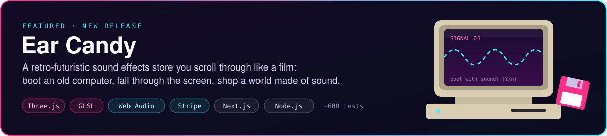
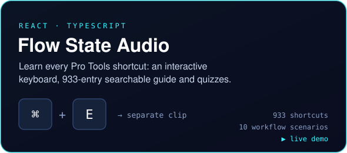

  
  
  

### `> whoami`

I started out behind a mixing console before I moved behind a code editor. Now I build web apps in **React and TypeScript** with the same instincts a studio teaches you: obsess over the details people *feel* before they notice, ship things that hold up under pressure, and make the tools you use every day faster.

- 🎧 **Roots:** audio engineering & AV · B.S. Recording Arts, Full Sail University
- 🛠️ **I build:** interactive front-ends, internal tools and data-driven products
- 🤖 **How I work:** I pair with AI coding agents to ship fast, then sweat the polish and the tests myself
- 🔭 **Looking for:** Software Engineer roles (React / TypeScript, internal products & data)

 

### `> ls ./projects`

 

### `> cat stack.txt`

  
  
  
  
  
  
  
  
  
  
  
  
  

 

  <code>signal ended</code> · thanks for scrolling 🎛️

